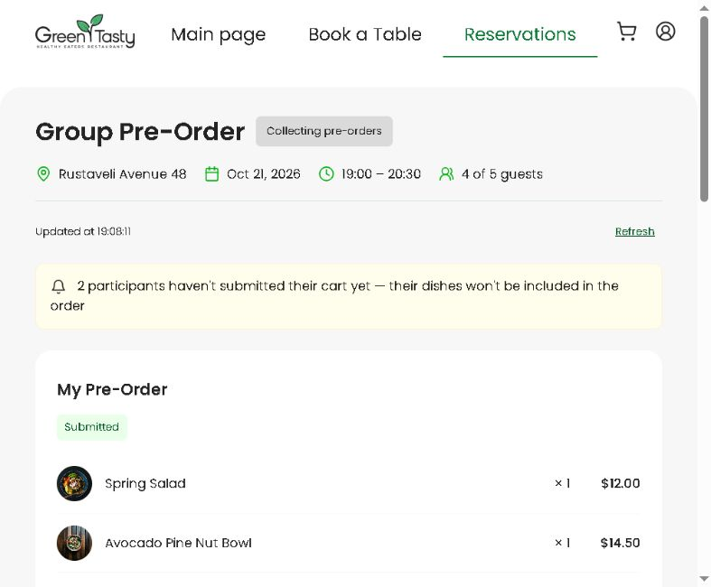
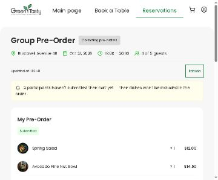
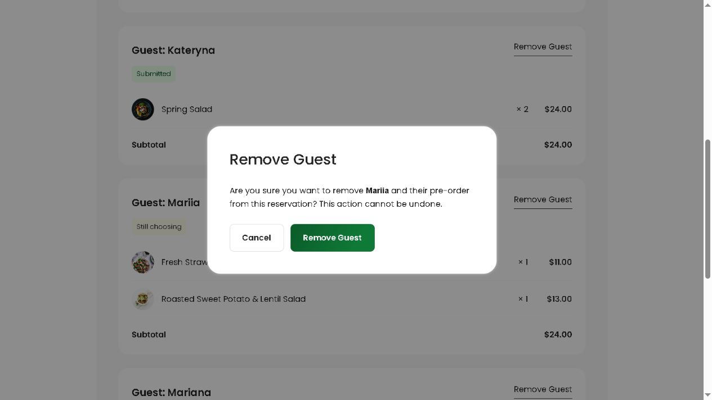
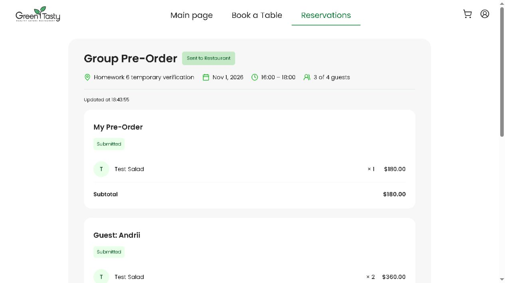

# Frontend ДЗ №6 — Owner групового pre-order

Реалізовано всі три рівні та бонус Remove Guest у поточному Angular-проєкті. Вихідні вимоги: [homework-frontend.md](../../homework-frontend.md), [практичне](../../practice-frontend.md), [дизайн і межі макета](../../homework-design/README.md).

## Запуск

```sh
cd frontend/restaurant-frontend-app
npm ci
npm start
```

Демо без акаунта та backend: [localhost:4200/reservations/demo-reservation/group-order?demo](http://localhost:4200/reservations/demo-reservation/group-order?demo).

Моки й demo login реєструються лише в development. Після reload mock store скидається. Демотокен не пересилається у справжній API; збережена демосесія прибирається перед production-авторизацією.

Справжній API вже налаштований у development: `https://njnyvufs51.execute-api.us-west-2.amazonaws.com/develop`. Вийдіть із demo через Sign Out і ввійдіть як Customer. Відкрийте `/reservations/<reservationId>/group-order`. Старий шлях `/group-pre-order` перенаправляє на цей самий екран.

## Що зроблено

- Семантичний адаптивний екран за PNG: дані бронювання, картки зі стравами, Subtotal, текстові статуси, My Pre-Order, Grand Total; перевірена ширина 375 px.
- Стан на signals/computed, typed HTTP service, loading/error/empty, Try again.
- Consolidated pre-order об'єднує однакові dishId й виключає чернетки гостей. Grand Total береться з цієї консолідації. Особистий внесок Owner узгоджений з реальним backend.
- Submit через спільний app-modal: один POST навіть за подвійного кліку, success toast, Submitted/read-only; помилки API показує interceptor без дублювання.
- Фонове оновлення кожні 15 секунд, ручний Refresh, Updated at і stale warning. Запити не накладаються, не перезаписують mutation, таймер завершується після Submit/Closed та виходу зі сторінки.
- Remove Guest із підтвердженням та aria-label з ім'ям; snapshot оновлюється відповіддю DELETE. Owner і надіслану групу змінювати не можна.
- Підтримано повторне відкриття submitted/заповненої групи: коли публічний invite вже недоступний, використовується перевірка Owner та деталі його бронювання.
- Підготовка старих груп залишається окремою явною дією; Submit не створює відсутній Order приховано.

## Код і тести

- `frontend/restaurant-frontend-app/src/app/pages/group-order-page/`
- `frontend/restaurant-frontend-app/src/app/components/group-orders/participant-card/`
- `frontend/restaurant-frontend-app/src/app/services/group-orders/`
- `frontend/restaurant-frontend-app/src/app/shared/mocks/`
- Оригінальні [тести за рівнями](../../frontend/restaurant-frontend-app/homework-tests/README.md).

Активні тести скопійовані без зміни оригінальних assertions: practice + level-2 + level-3 + level-3-bonus. Level-2 замінює статичний page spec рівня 1, як вказано у README тестів. Оригінал level-1 збережений у homework-tests.

```sh
npm run test:hw -- --browsers=ChromeHeadless
npx tsc -p tsconfig.app.json --noEmit
npx tsc -p tsconfig.spec.json --noEmit
```

Production build у PowerShell:

```powershell
$env:BACKEND_URL = 'https://njnyvufs51.execute-api.us-west-2.amazonaws.com/develop'
npm run build
```

Базовий повний frontend-набір перед змінами: **213 passed / 46 failed**. Перший повний запуск після реалізації: **281 passed / ті самі 46 failed**, нових невдалих тестів немає. Фінальний запуск після виправлення review: **285 passed / ті самі 46 failed**, нових помилок немає. `npm run test:hw -- --browsers=ChromeHeadless`: **85/85**. Розширений набір feature/regression: **111/111**. Обидві TypeScript-перевірки й production build успішні; initial bundle **795,72 кБ**. [Протокол](verification.json), [точні назви старих помилок](known-test-failures.md). Повний набір не оголошується зеленим за результатом лише test:hw.

## Перевірка на справжньому AWS 30.10.2026

Тимчасовий Customer увійшов через справжню форму, Cognito та API. Кошики створено через публічні guest API; моки для цих ID не застосовувалися.

1. Owner і троє гостей: консолідація **$540**, загальна сума всіх кошиків **$940**.
2. Гість Olena підтвердив свій кошик окремим HTTP-запитом. Без reload/Refresh Owner автоматично побачив Submitted та новий Grand Total **$760**.
3. Remove Guest через UI видалив тестового гостя; лишилося троє учасників.
4. Submit через UI надіслав **Test Salad × 3 + Test Soup × 1**. Екран став read-only.
5. Повторне відкриття зберегло **Sent to Restaurant**, три картки й **$760**.
6. На іншому тимчасовому бронюванні перевірено empty і disabled Submit; для відсутнього ID — 404/error.

Після перевірки **15 тестових записів та 1 користувач Cognito видалені, їхню відсутність підтверджено**. Ідентифікатори в доказах історичні. Паролі й токени не додаються до репозиторію.

[Скриншоти](screenshots/) та [JSON-протокол](verification.json) додані до цього каталогу. Кошики й фінальний статус перевірені на AWS через браузер; окреме виправлення race condition Submit перевірене трьома регресійними тестами RED → GREEN. Якщо відповідь Submit містить інші страви/кількості, екран перечитує фінальні дані один раз. До завершення цього читання стара сума не показується як остаточна; при помилці є Refresh, статус лишається Submitted. Публічного frontend URL в AWS наразі немає через чинне блокування CloudFront; ця робота не заявляє про його розгортання.

## Використання AI

Використано Codex для звірки архіву, реалізації компонентів і HTTP-адаптера, запуску оригінальних та додаткових регресійних тестів і перевірки через браузер. Результат перевірено TypeScript, production build, Karma/Jasmine та реальним сценарієм на AWS із прибиранням тимчасових даних. Окремий агент перевірив дизайн; незалежне фінальне review знайшло один P2; його виправлено й перевірено регресійними тестами. [Результат review](code-review.md).

## Приклади екранів









Код для ДЗ №6 розміщений у гілці `feature/frontend-homework-6` цього репозиторію.
